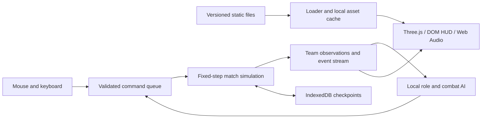

# Browser League clone: recommended build strategy

Research review: September 13, 2026. Based on the existing repository through `f071556`, its pinned source records, and the primary references linked below. This is the decision brief; [DESIGN.md](DESIGN.md) specifies the systems and [REFERENCE-VALIDATION.md](REFERENCE-VALIDATION.md) specifies how to measure fidelity. It does not claim exhaustive recovery of undocumented League behavior.

## Product and architecture

Build a complete desktop local match: one player, four allied bots, five opposing bots, three lanes, jungle, objectives, builds, and Nexus victory. Preserve reference pacing. Practice scenarios are the development instrument, and a polished duel is an intermediate gate. Quality takes precedence over the number of selectable champions.

Keep the existing TypeScript/Vite + Three.js architecture. Simulate movement and combat on a plane and render the battlefield in 3D. Use HTML/CSS for the familiar HUD and Web Audio for sound. A browser-only requirement does not require sprite approximations or a simplified battlefield. Three.js supplies the rendering layer; game rules and tooling remain our responsibility. [Three.js renderer](https://threejs.org/docs/pages/WebGLRenderer.html)

All match authority stays on the device. Static HTTPS hosting serves files; there is no runtime game API, remote AI, account dependency, or game server. Offline play follows verified caching of the selected content. Reliable internet PvP is a different scope: WebRTC still needs connection negotiation and may need relays. [MDN connectivity](https://developer.mozilla.org/en-US/docs/Web/API/WebRTC_API/Connectivity)

## Research that must drive implementation

Freeze standard PC Summoner's Rift **26.18**, with an explicit client build and hotfix cutoff for measurements. The existing content starts from Data Dragon **16.18.1** and pinned CommunityDragon **16.18** records. Keep these version namespaces separate. A current patch page documents changes, and static exports do not contain a complete executable ruleset. Riot also notes that Data Dragon updates can lag patches. [Official patch](https://www.leagueoflegends.com/en-us/news/game-updates/league-of-legends-patch-26-18-notes/), [Data Dragon](https://developer.riotgames.com/docs/lol#data-dragon), [versioned CommunityDragon directory](https://raw.communitydragon.org/16.18/)

| Evidence | Use | Required restraint |
|---|---|---|
| Official guides and patch history | Mode, rule changes, named exceptions | Reconcile inherited rules and subsequent hotfixes |
| Hashed raw records and reproducible converters | Map coordinates, stats, authored models, animations, effects, sound | Do not assign speculative meanings to unknown fields |
| Controlled native captures | Camera, input response, release timing, collisions, visibility, audiovisual transitions | Retain setup, original footage, repetitions, and measurement uncertainty |
| Browser scenarios and profiling | Regression safety, repeatability, cost, loading, save continuation | Passing local tests alone does not establish native fidelity |

Use a discrepancy ledger with an ID, source/build, setup, observed result, local result, confidence, and acceptance scenario. Prioritize an issue by player impact, frequency, dependency reach, and strength of evidence. Do not let easily imported particles displace unresolved combat or match rules.

The first native measurement packet should cover camera landmarks, unobstructed movement and corners, attack cancellation before/after release, the complete Ashe kit, brush and vision expiry, minion waves, and turret aggression. Use the existing [experiment IDs and capture schema](REFERENCE-VALIDATION.md). Native captures have not been established by this review; no pixel-parity claim is justified.

## Accuracy priorities and completion gates

| Order | Deliverable | Evidence required to proceed |
|---|---|---|
| 1 | Camera, pointer targeting, movement, unit collision, attack cadence | One camera fit across held-out locations; repeated movement and attack comparisons; boundary/cancel scenarios |
| 2 | Complete Ashe and Lux, including passive, ranks, audio, effects and tactical AI | Full casts from input through cleanup; collisions, CC, resource timing and kit interactions agree with supported reference evidence |
| 3 | Complete lane economy and structure progression | Both teams receive correct rewards; shared XP, assists, shutdowns, shop recipes and base progression pass independent scenarios |
| 4 | Jungle, major objectives, vision tools, selected runes and role systems | Complete lifecycle and reward tests; objective consequences change combat and pushing |
| 5 | Six complete champions supporting all five roles and nine bots | Seeded full matches reach valid results; bots farm, buy, rotate, contest, retreat and convert advantages without hidden information |
| 6 | Browser delivery and final visual calibration | Named device/browser frame budgets, offline reload, first-use effects, save recovery and full reference comparison set pass |

Stages can overlap where dependencies allow. Profile throughout; do not postpone performance until the last stage. Keep all offscreen lanes and camps authoritative. Finish each champion as a complete content unit before expanding the catalog. The initial six research cases are Ashe, Lux, Garen, Master Yi, Leona, and Ahri; mirrors allow complete teams before ten distinct kits are ready. Full-roster parity remains a much larger content and interaction program.

## Decisions that protect long-term quality

**Simulation:** use a fixed 60 Hz local clock, stable command/event ordering, explicit entity IDs, seeded random streams, and serializable state. The frequency is our implementation choice, not a claim about the native server. Attack windup, release and recovery are separate states. Effects never apply damage from animation callbacks. Test equal-tick events, posthumous projectiles, target loss and expiry boundaries. Compare replay checkpoints and diagnose the first divergence; Riot's own account illustrates why deterministic behavior needs verification. [Riot determinism investigation](https://www.riotgames.com/en/news/determinism-league-legends-fixing-divergences)

**Combat and progression:** make spells data-driven where rules actually repeat, with explicit champion exceptions. Capture death-event inputs before distributing rewards so recipient iteration cannot change level-based results. Separate killer attribution, assist eligibility, reward amounts and nearby XP eligibility. Do not infer one timer from a similarly named mechanic. Keep role-dependent caps and inventory behavior out of universal constants until the frozen mode is reconciled.

**AI:** give each team a strategic planner, each champion a tactical policy, and all actors the same command validation as the player. Start with staggered strategic decisions at 1–2 Hz and tactics at 5–10 Hz, then profile. Difficulty should affect reaction, prediction and decisions. Team-filtered observations and aged memory must be the only opponent information available to bot decision code. A nine-bot match succeeds when lane pressure, recalls, ganks and objective conversion form a coherent game.

**Rendering:** calibrate projection and scale before materials. Preserve original source quality as the comparison baseline. Optimize draw calls, conservative animation bounds, texture formats and offscreen effects using frozen-view equivalence tests. Reduce decorative work before telegraphs or visibility accuracy. Independent skeletal animation needs a deliberate batching strategy; ordinary mesh instancing does not solve it automatically.

**Delivery:** selected champions and critical effects must be ready before a match starts. Pin saves to code/content revisions. Use atomic offline pack readiness, periodic checkpoints, and export/import. Handle quota failure and eviction; persistent storage is a request, and local browser data still needs recovery paths. [MDN storage behavior](https://developer.mozilla.org/en-US/docs/Web/API/Storage_API/Storage_quotas_and_eviction_criteria)

## Where this repository stands

The practice build already provides imported Rift terrain/navigation, an animated Ashe, lane minions, structures, local combat, vision, checkpoints, and a small shop. Recent work separates champion ownership and tracks damage and Hawkshot reveal assists. It is a useful foundation, but it is not the complete match described above.

The highest-impact remaining gaps include dynamic unit collision, complete ability ranks and interactions, champion-death XP and gold rules, item recipes/runes, jungle/objectives, nine role-aware bots, and native visual/timing comparisons. For example, [champion-kill XP](CHAMPION-KILL-XP.md) still documents a human-only flat 180 XP approximation despite a richer pinned source curve. Assist counters do not mean assist gold or execution attribution is complete.

The last recorded full-Rift benchmark tested **`d361405`**, not the current revision: 103 unit records, 231 draw calls, 379,519 triangles, frame p95 **18.3 ms**, p99 **22.6 ms**, and simulation p95 **0.3 ms** on Chrome 152 / Apple M5 Pro at 1080p. It sampled 180 frames and omitted complete 5v5/camp/spell stress. The frame target remains unmet. The same record reports 124 passing browser cases at that revision. Later focused checks do not replace a current full-suite run. [Recorded evidence](reference/runtime-verification.json)

The map's source texture path alone transfers approximately **145.77 MB** and allocates an estimated **327.42 MiB** of GPU block storage. The existing 60 MB core-pack and 256 MiB texture targets therefore require a measured delivery strategy or an explicit budget revision. Do not silently trade away the requested visual quality. [Map audit](MAP-ASSETS.md)

## Recommended next work

1. Populate the native capture packet for camera, movement and attacks; retain uncertainty where source behavior cannot yet be observed.
2. Close shared combat/economy foundations before a second large effects investment: dynamic collision, complete Ashe rules, champion reward transactions and real item recipes.
3. Use Lux and a complete lane duel to expose missing shield, recast, projectile and CC semantics.
4. Expand the battlefield rules and role AI into complete seeded matches, then certify the full stress scene and offline/browser behavior.

The complete design and [roadmap](ROADMAP.md) remain the scope. Exact Riot content has a separate distribution dependency: Riot's published developer policy excludes games using its IP, so publicly accessible source assets do not establish release authorization. [Riot policy](https://developer.riotgames.com/docs/lol#developer-api-policy)
