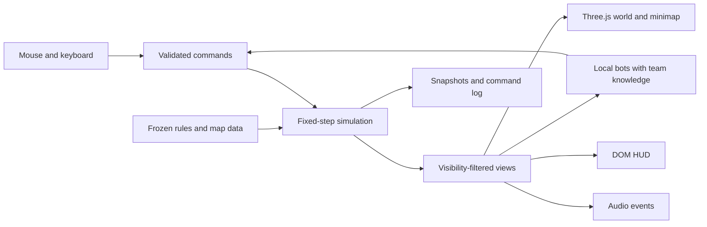

# Browser League-like MOBA: game and technical design

Initial research: September 12, 2026, America/New_York. Design reviewed September 13 against the existing practice build. This document specifies the target; [PROGRESS.md](PROGRESS.md) records implementation and measured results. The [fidelity plan](FIDELITY-PLAN.md) defines the next comparison and production gates.

## 1. Recommended product

Build a desktop browser MOBA with a full three-lane battlefield, one human player, four allied bots, and five opposing bots. Preserve the familiar rhythm of laning, last-hitting, trading, recalling, buying, rotating, contesting objectives, and ending at the enemy base. Use a fixed-angle 3D camera with a 2D simulation underneath it.

Prioritize fidelity in this order:

1. Input response, movement, targeting, attack cadence, and spell timing.
2. Camera framing, unit proportions, animation, readable effects, and sound.
3. Minion waves, structures, economy, vision, and objective consequences.
4. Bots that make these systems meaningful across a complete match.
5. Champion and item breadth, with each addition meeting the same quality standard.

These priorities govern development order, not the final feature ceiling. A polished duel is a milestone toward the full match, not a substitute for it.

**Primary mode:** complete local 5v5 matches at reference pacing. A provisional 25–40 minute playtest window is a planning assumption, not a verified League average or a forced match timer. If matches stall, fix decision-making and objective conversion before speeding up gold, waves, or damage.

**Secondary modes:** practice with dummies and reset controls; focused last-hit/skillshot scenarios; local replay and spectator review. A clearly labeled accelerated mode may be added after reference pacing works.

**Target platform:** keyboard and mouse, desktop Chromium, Firefox, and Safari with WebGL 2. Design small-screen menus gracefully, but keep touch combat as a separate future control design; trying to reproduce mouse control on a phone would change the primary experience.

## 2. What no backend means

All authoritative match state runs inside the player's browser: units, combat, AI, random numbers, timers, economy, and victory. A static HTTPS host distributes HTML, JavaScript, WASM decoders, audio, models, and versioned data. A development server is tooling, not an application backend.

| Capability | Decision |
|---|---|
| Solo 5v5 with bots | Full target |
| Offline matches | Supported after the selected content pack finishes caching |
| Saves, preferences, match history | Local to this browser profile, with export/import |
| Practice, pause, replay | Full target; useful advantages of local simulation |
| Accounts, matchmaking, trusted rankings | Outside this architecture |
| Competitive anti-cheat | Cannot be guaranteed when the player owns all state |
| Internet PvP | Separate future architecture decision |

WebRTC can transport peer data, but peers still need signaling, and some networks require TURN relays. Manual connection exchange can support experiments; it is not a dependable ten-player, zero-infrastructure service. Do not put multiplayer into the critical path. [MDN WebRTC connectivity](https://developer.mozilla.org/en-US/docs/Web/API/WebRTC_API/Connectivity)

Serve and cache assets from the same origin. Ship no Riot API key. Gameplay must not fetch current balance data or call remote AI services. Downloading additional content is an explicit action outside an active match.

## 3. Fidelity contract and reference version

Use **standard PC Summoner's Rift patch 26.18** as the research target. Riot published its notes on September 9, 2026; Data Dragon 16.18.1 was directly checked during this research. Standard Summoner's Rift must remain separate from Classic, Swiftplay, ARAM, and Wild Rift. Those modes can appear on the same patch page and must not contaminate the ruleset. [Patch 26.18](https://www.leagueoflegends.com/en-us/news/game-updates/league-of-legends-patch-26-18-notes/)

Freeze a local ruleset after validating it. Never use a moving `latest` URL in the shipped game. Keep the gameplay patch, Data Dragon build, content revision, source hashes, and known deviations together. A patch note is a change log, so 26.18 notes alone cannot reconstruct all pre-existing rules.

The 2026 season introduced systems including role quests, Faelights, and Crystalline Overgrowth. Its launch changes also removed Atakhan and Feats of Strength. These are reminders to audit the full 26.1→26.18 history, not permission to assume launch values remain current. In particular, inventory capacity and level caps need role-dependent policies. [Season launch notes](https://www.leagueoflegends.com/en-us/news/game-updates/patch-26-1-notes/)

Every mechanic receives one of four labels:

- **Verified data:** a specific field checked in a versioned source; this does not establish its full gameplay meaning.
- **Verified behavior:** reproduced in a controlled reference observation or supported by sufficiently specific official documentation.
- **Proposed approximation:** an explicit implementation choice pending comparison.
- **Unimplemented:** part of the target but absent from the current build.

No numeric fidelity percentage should be reported without a defined denominator and measured tests. A screenshot resemblance score cannot stand in for combat accuracy.

## 4. Content and asset boundary

Riot's fan policy explicitly excludes unauthorized games using its IP, including characters, abilities, maps, and items. Public asset availability and noncommercial distribution do not supply that authorization. Exact League content is a licensing dependency; this document does not assume a license exists. [Riot's policy](https://www.riotgames.com/en/legal)

Keep the simulation and presentation content replaceable. Champion names below identify research references. A licensed reproduction can use licensed content under its terms. An independently authored release needs its own characters, designs, environments, effects, audio, and identity; merely renaming copied content is not the proposed solution.

Do not plan around screenshots as map textures, ripped voice packs, or public data endpoints as a ready-to-ship asset library. Exact visual reproduction is not something procedural placeholder models can honestly promise. Character art, rigging, animation, environment painting, effects, and sound require a real production pipeline.

## 5. Stack and architecture

| Layer | Choice | Reason for this project |
|---|---|---|
| Language/build | TypeScript, strict mode, Vite | Inspectable local simulation and static output |
| Renderer | Three.js, WebGLRenderer | Direct control over the fixed camera, skinned models, effects, and fog |
| Simulation | Pure TypeScript modules with stable entity IDs | Headless testing, replay, and renderer independence |
| Navigation | Pinned source grid, radius-aware A*, swept capsule clearance, path smoothing | Preserve the imported map's collision semantics; add dynamic overlays and local avoidance |
| Collision | 2D circles, capsules, swept queries, authored obstacles | Explicit game rules without rigid-body drift |
| UI | HTML/CSS with typed view models | Clear text, rebinding, shop, settings, tooltips |
| Audio | Web Audio | Event scheduling, mixing, voice limits |
| Models | GLB/glTF 2.0 | Consistent mesh, skeleton, and animation delivery |
| Optimization | glTF Transform, Meshopt where beneficial, KTX2 textures | Control download size and GPU memory |
| Storage | IndexedDB, versioned Cache API entries | Saves and offline content |
| Verification | Unit/scenario tests, Playwright, SpectorJS | Rules, interaction, visual QA, and GPU inspection |

Phaser is Game Studio's default for 2D games. Its own documentation describes a 2D framework without built-in 3D rendering. For this request, 3D presentation is the recommendation derived from prioritizing League's visual fidelity. Three.js is a renderer, so navigation, match rules, and tooling remain work we must build. [Phaser scope](https://docs.phaser.io/phaser/getting-started/what-is-phaser), [Three.js renderer](https://threejs.org/docs/pages/WebGLRenderer.html)

React Three Fiber is reasonable inside an existing React product; this repository already uses plain TypeScript and Three.js. Babylon.js or PlayCanvas merit a short production spike if an editor workflow becomes the decisive need. Do not change engines based on a single attractive demo.

Use WebGL 2 as the initial acceptance path. Three.js also offers a WebGPU renderer with WebGL 2 fallback; that is a viable later evaluation, not a prerequisite for quality. A material/postprocessing migration still needs its own verification. [WebGPURenderer](https://threejs.org/docs/pages/WebGPURenderer.html)

No Rapier dependency initially: combat is kinematic and planar. Add a physics engine only for a mechanic that actually needs physical response; cosmetic rubble must not alter combat collision.

Rendering must never create damage, grant gold, or decide whether something is visible. Animation events can be authoring references, but simulation time determines when an attack connects.

## 6. Simulation clock, state, and input

Start with a **60 Hz fixed simulation** and independent display refresh. This is our design choice, not a claim about League's server tick rate. Store gameplay deadlines as integer ticks or explicitly quantized durations. Interpolate remote units between snapshots; keep local cursor, selection, and targeting feedback responsive. Measure the additional interpolation delay before deciding how the controlled champion is presented. [Fixed timestep rationale](https://gafferongames.com/post/fix_your_timestep/)

The simulation initially runs on the main thread to simplify input and debugging. Profile the complete match. Move it to a dedicated worker only if the measured CPU budget requires that change. Use transferable buffers before requiring shared memory or cross-origin isolation. A worker is still local and is not a backend.

Use seeded PRNG streams for gameplay, AI, and cosmetics separately; stable iteration order; monotonically allocated IDs with safe reuse; explicit pending-event queues. Save RNG states. Deterministic replay is a goal within the validated build/runtime matrix, not an automatic consequence of TypeScript or a fixed step. Hash replay checkpoints and test across engines before claiming cross-browser determinism.

Cap catch-up work after long stalls. On hidden-tab or focus-loss transitions, pause the solo match, release held inputs, and resume explicitly. Do not simulate minutes of missed combat when the tab returns. Browsers throttle background work, so wall-clock time must not silently become match time. [Page Visibility API](https://developer.mozilla.org/en-US/docs/Web/API/Page_Visibility_API)

Proposed system ordering, to be refined against edge cases:

1. Drain input and bot commands in a stable sequence; reject commands that fail state, resource, or target rules.
2. Apply command transitions, movement, dashes, and collision resolution.
3. Update authoritative visibility for this tick before target acquisition.
4. Advance attack/cast timelines and sweep projectiles through their traveled segments.
5. Resolve ordered hit events, mitigation, shields, CC, death, and triggered effects.
6. Apply regeneration, progression, wave/objective timers, and structural state changes.
7. Produce team-filtered observations, schedule AI decisions, and publish presentation events.

Expiry, equal-timestamp lethal hits, resets, and posthumous projectiles need explicit policy and tests. Do not let array order accidentally decide match rules.

### Controls

| Action | Proposed familiar default |
|---|---|
| Move / attack valid target | Right-click |
| Inspect/select | Left-click |
| Abilities | Q W E R |
| Summoner spells | D F |
| Attack move | A then click; configurable direct cast |
| Stop | S |
| Recall | B |
| Shop | P |
| Scoreboard | Hold Tab |
| Recenter / camera lock | Hold Space / Y |
| Level an ability | Ctrl + ability key, rebindable |
| Inventory / trinket | Configurable slot bindings |
| Cancel aim / close top modal | Escape |

Provide normal cast, quick cast, quick cast with indicator, self-cast, attack-move target preference, target-champions-only, edge-pan sensitivity, and camera-lock preferences. Treat these as explicit settings; verify exact reference interactions instead of conflating target-champions-only with all attack-move behavior.

Suppress browser context menus only over the game surface. Prevent default Tab/Space scrolling while combat owns focus. Ignore combat bindings while typing or interacting with modal UI. Fullscreen is optional. Camera movement must never leak through a shop drag or minimap gesture.

## 7. Map, camera, navigation, and vision

### Battlefield

The reference topology is two opposing bases, three lanes, a diagonal river, jungle quadrants, defensive structures, neutral camps, brush, and objective pits. Riot's guide describes three lane turrets and an inhibitor per lane, plus two turrets protecting each Nexus. Match geometry and the state transitions that expose these targets both matter. [Official game guide](https://www.leagueoflegends.com/en-us/how-to-play/)

Author separate but aligned layers:

- Terrain visuals and decorative height.
- Walkable navigation polygons with clearance.
- Gameplay blockers and their collision categories.
- Vision blockers and brush-region IDs.
- Lane routes, wave spawn anchors, and structure sockets.
- Camp spawn/leash/reset zones and objective regions.
- Team-specific visibility, minimap, and camera bounds.
- Elemental map variants and their navigation/vision changes.

Keep game coordinates in one consistent unit system. Convert to smaller render units at the adapter boundary; all movement, targeting, and skillshot calculations use game units. The exact map dimensions, wall contours, and travel distances remain measurement tasks. Do not substitute an arbitrary square size and call it accurate.

### Camera

Use a fixed yaw and pitch with limited zoom, edge pan, minimap navigation, and optional champion follow. Start with a perspective camera and a provisional 40–50° downward pitch, then fit it to matched reference screenshots. Orthographic projection is a comparison candidate; do not assume that “isometric” proves an orthographic camera.

Calibrate projected champion height, attack-range circles, lane width, visible world area, and HUD size together. Fix camera orientation during normal play. Test both team sides. Keep visual elevation separate from planar aim to avoid river-height skillshot confusion.

### Movement

Use the pinned source navigation grid with radius-aware A*, swept capsule clearance, and path smoothing, as documented in [the map audit](MAP-ASSETS.md). Replan on meaningful obstruction or target changes. Add dynamic blocker overlays and soft local avoidance with bounded corrections, while walls remain hard constraints. Minions follow lane guidance until aggro temporarily takes over.

Unreachable clicks project to reachable boundaries. Dashes and blinks have explicit wall-crossing policies. Clicking a target approaches the appropriate attack/cast range rather than its center. Keep visual footprint, selection radius, pathing radius, and hit radius distinct.

Test the source grid against diagonal corridors, narrow passages, structure boundaries, and measured reference paths. A polygon mesh and funnel are an alternative only if a comparison demonstrates better fidelity or necessary performance without losing source flag semantics. Do not replace the source grid solely because another navigation representation is more conventional.

### Vision

Compute visibility on the CPU from team vision sources, occluding geometry, brush membership, and reveal effects. Begin with a tunable grid and refine near critical boundaries. Render a higher-resolution smoothed mask. Never use the blurred mask to decide targetability. Riot's historical fog article is useful evidence for separating visibility data from visual smoothing; its old grid dimensions are not current specification. [Fog implementation study](https://www.riotgames.com/en/news/story-fog-and-war)

The map terrain is known from the start; fog conceals dynamic enemy information. Invisible enemies must disappear from meshes, health bars, selection, minimap, ordinary positional audio, and bot targeting. Explicit global/reveal mechanics use separately tested exceptions.

Store last-known enemy observations with timestamps. Shared bot knowledge contains only team-visible observations and permitted inference. Changing the renderer to hide a unit does not stop a bot from cheating if its API can still read the full world.

Brush, stealth, camouflage, true sight, wards, sweepers, Faelight zones, and attack reveal are distinct policies. Implement the policies required by the roster and objectives first, then expand. Exact duration and interaction values belong in the reference ledger.

## 8. Combat: where clone accuracy is won

### Basic attacks

Represent acquisition, approach, windup, release/hit, and recovery separately. Moving before release can cancel an attack; moving after release must not erase a projectile already in flight. An attack reset is an explicit rule, not a universal side effect of pressing a spell.

Test melee contact and ranged travel separately. Define target death/loss, invalid target, stasis, untargetability, and range-change behavior. Maintain the next permitted attack time independently from the movement state so kiting cannot create extra attacks.

Different champions can have different attack-speed ratios, windup scaling, missile speed, and reset rules. A single shared animation or delay across the roster would be visibly wrong even if DPS were similar.

### Spells and effects

The ability system needs targeted effects, directional missiles, cones, ground circles, linear beams, returning missiles, dashes, blinks, channels, toggles, charges, recasts, pets/summons when required, and delayed triggers.

Use reusable components with a small champion-specific handler for exceptions. Avoid inventing a general-purpose scripting language before the first complete kits prove the necessary abstractions.

A spell specification includes cast validation, cost timing, cooldown start, windup, movement lock, interruption categories, target filters, geometry, collision masks, damage type/scaling, status effects, recast windows, vision rules, and animation/VFX/SFX bindings. Tooltips consume the same normalized values but do not define executable behavior.

Sweep fast projectiles over their entire tick movement to prevent tunneling. Returning spells track per-target hits separately for outbound and inbound phases. Recasts and channels carry explicit state, so repeated input cannot duplicate damage or consume costs twice.

### Stats and damage

Use typed modifiers and a documented resolution order for base stats, growth, flat/percentage modifiers, resistance reduction, penetration, mitigation, shields, and triggered effects. Proposed familiar candidates include `100/(100+R)` for nonnegative effective resistance and `baseCooldown × 100/(100+haste)`; confirm applicable reference semantics and rounding before promoting them to verified rules. Negative resistance and special cases require their own branches.

Physical, magical, and true damage remain distinct. True damage must not automatically mean shield bypass. Lifesteal, other healing, healing reduction, crit exceptions, on-hit effects, and spell effects need individual eligibility rules. Stat growth must be validated rather than assumed linear from a `perlevel` field.

CC is a capability system: whether an actor can move, attack, cast, turn, or receive orders. Root, silence, stun, knockup, suppression, fear, charm, slow, and untargetability are not synonyms. Add stacking, refresh, immunity, tenacity, and cleanse rules only through explicit policies and scenarios.

## 9. Roster strategy

Use six champions as reference cases covering all five roles, with mirror picks initially. Each gets a complete passive and Q/W/E/R behavior set, suitable animations, effects, sounds, and bot support before being called playable.

| Reference | Role in initial test roster | What it forces the engine to support |
|---|---|---|
| Ashe | Bot carry; first movement/attack reference | Ranged attacks, slows, attack enhancement, multi-projectile aim, scouting |
| Lux | Mid or support; first spell reference | Multi-target binding, returning shield, persistent/recast zone, beam |
| Garen | Top | Melee reset, defensive timing, moving area damage, finisher |
| Master Yi | Jungle | On-hit sequencing, temporary untargetability, channel, buff/reset interactions |
| Leona | Support | Engage dash, empowered attack, defensive buff, differentiated area CC |
| Ahri | Additional mid; animation benchmark | Returning projectile, charm, multi-cast mobility, takedown interactions |

These are research cases, not an asset-use license. The first two establish combat foundations. Ahri is an early visual target because a character with moving secondary forms and clear spell identity exposes weak animation production quickly. Her full kit follows basic projectile and dash infrastructure. [Ashe](https://www.leagueoflegends.com/en-us/champions/ashe/), [Lux](https://www.leagueoflegends.com/en-us/champions/lux/), [Ahri](https://www.leagueoflegends.com/en-us/champions/ahri/)

The data sample verifies that versioned stats for all six can be retrieved. It does not establish charge timers, windups, complete formulas, or current page descriptions as historical patch behavior.

After the full match passes its quality gates, expand to ten distinct champions covering two balanced compositions. Full-roster coverage is a long-term content program with substantial interaction testing; do not imply it is a small final step.

## 10. Match systems and economy

**Ambient income reference:** standard Rift's pinned mode data and the 2026 game-start notes agree on a 65-second start, with 10.2 gold per five seconds. Preserve fractional balances separately from whole-gold display. The precise credit cadence still requires a matched reference observation; see the [economy specification and evidence](ECONOMY.md) for the implemented policy and remaining rewards audit.

**Minions:** melee, ranged, siege, and super variants; patch-specific wave composition/scaling; target priority, leash and reacquisition; last-hit gold; experience eligibility and sharing; champion aggression response. Wave timing, movement, and attack cadence must be coherent enough for slow pushes and stacked waves to emerge.

**Structures:** target priority, champion-attack retaliation, shot escalation if applicable, range feedback, projectile handling, plates, defenses, backdoor rules, inhibitor destruction/regrowth, super-wave consequences, and base exposure. Encode structural dependencies explicitly and test a full lane-to-base sequence.

**Jungle:** camps with distinct aggro, leash, reset, respawn, rewards, and buffs; jungler progression and summoner interactions. Both teams' camps and every lane continue simulating offscreen. Rendering culling is not permission to stop economic simulation.

**Major objectives:** define spawn/despawn and respawn state machines, contest behavior, kill attribution, rewards, team buffs, and expiry. Audit drakes, elemental transformations, soul/Elder progression, grubs, Herald, and Baron against the frozen patch. Their value must influence bots' decisions and pushing behavior.

**Champion progression:** XP thresholds, ability rank restrictions, role progression, respawns, kill/assist/shutdown attribution, passive income, recall interruption, fountain restoration, and reference movement bonuses. Keep ordinary rank limits distinct from patch-dependent role level caps.

**Shop:** functional component recipes, combination cost, owned-component consumption, capacity rules, uniqueness groups, active cooldowns, consumables, sell values, and limited undo where applicable. Provide search, stat filters, build tree, and role-aware recommendations. Show all implemented items; do not display unusable catalog entries as if they work.

**Runes/loadouts:** early scenarios may pin explicit presets. The complete reference mode needs every selected rune effect and dependency implemented, then a broader editable catalog. Stat shards, keystones, and triggered item effects must not become decorative icons.

Stage one item coverage around six sensible builds and meaningful alternatives, approximately 30–40 completed items plus their components as a planning estimate. The target is complete behavior for shipped content; exact count follows the recipe and interaction audit.

## 11. Bots are a principal game system

Use local hierarchical utility AI with reusable actions and champion-specific tactical evaluators. An online LLM is incompatible with offline matches and unnecessary for frame-level decisions.

| Layer | Proposed frequency | Responsibility |
|---|---|---|
| Shared team planner | 1–2 Hz, plus urgent events | Defend lanes, assign objective participation, push, split, regroup |
| Individual tactics | 5–10 Hz, staggered | Farm, trade, kite, retreat, recall, ward, approach a fight |
| Action execution | Every simulation tick | Follow paths, honor cast/attack states, execute committed orders |
| Perception memory | Tick events + bounded refresh | Track only observable facts with age and uncertainty |

These are starting budgets. Tune reaction delay separately from update frequency. Proposed difficulty bands are roughly 180–350 ms reaction delay for strong bots and 350–600 ms for easier bots, with aim/decision errors; these are design settings, not measured human benchmarks.

Utility considers health, mana, cooldowns, target access, expected damage, nearby support, turret threat, incoming waves, objective reward, and retreat routes. Use hysteresis and short commitments to prevent indecisive oscillation. Reserve combat commands for tactical control while keeping movement execution continuous.

Roles need distinct policies: top manages a side lane; jungle follows efficient clears and chooses plausible ganks; mid balances farm and rotations; carry maintains safe damage uptime; support protects, engages, and establishes vision. The planner assigns these jobs without secretly reading hidden opponents.

Enemy spell readiness can be inferred from observed casts and known ranges of haste; it is not available as omniscient internal state. Perfect last-hitting, instant dodges, and enemies collapsing on an unseen player are failures, not difficulty features.

Use a threat field for traversal choices and safety margins around enemy turrets. Prevent endless low-health recall loops and repeated suicide paths. The team planner should convert won fights into structures or objectives instead of wandering until opponents respawn.

## 12. Visual and audio direction

Aim for a stylized painted battlefield with clear value hierarchy: subdued terrain; readable unit silhouettes; bright but bounded spell effects; strong team identification; crisp selection and impact feedback. Riot's clarity discussion emphasizes recognition, effect hierarchy, and restraint; our acceptance tests apply those principles to the proposed game. [Clarity in League](https://www.leagueoflegends.com/en-us/news/dev/clarity-in-league/)

Use authored terrain textures, baked ambient shading, limited dynamic lighting, controlled roughness, and selective rim/outline treatment. Avoid photoreal materials that make the map noisy at the gameplay camera. Shadows anchor champions; decorative foliage should yield when it obscures playable space.

Riot's 2017 renderer article documents terrain, animated meshes, outlines, particles, fog, and UI as separate concerns. It supports this layered approach, but its exact renderer and budgets are historical context. [Graphics pipeline study](https://technology.riotgames.com/node/55)

### Asset pipeline

1. Create style sheets and game-camera turnarounds for each character and environment family.
2. Author approved models in Blender, with consistent scale, pivots, forward direction, and named sockets.
3. Rig and animate idle, locomotion, attack variants, each required cast, recall, death, and respawn.
4. Export GLB; retain editable source files outside the runtime pack.
5. Prune, deduplicate, and selectively compress with glTF Transform; validate animation and materials after processing.
6. Produce texture variants and load KTX2 through supported transcoders.
7. Review assets in the actual game camera under teamfight lighting and fog.

Three.js provides GLTFLoader and KTX2Loader; glTF Transform provides processing tools. Compression ratios and animation quality must be measured per asset. [GLTFLoader](https://threejs.org/docs/pages/GLTFLoader.html), [KTX2Loader](https://threejs.org/docs/pages/KTX2Loader.html), [glTF Transform](https://gltf-transform.dev/)

AI-generated images can help with concepts, textures, and effect flipbooks. They do not replace reliable skeletal animation, coherent multi-angle geometry, or an art review. Do not make image generation a runtime dependency.

### Effects and sound

Each ability needs recognizable preparation, active geometry, travel/duration, impact, and decay. Bind the readable part of the effect to the collision shape; decoration may extend beyond it only if the hit region remains obvious. Use ground decals, ribbons, meshes, and pooled sprites as appropriate.

Mix separate channels for ambient sound, music, UI, attacks, spells, announcements, and voices. Prioritize major threats and impacts; limit simultaneous low-value sounds. Start/resume Web Audio after a user gesture. Fog filtering also applies to sound events except explicit global announcements. Avoid routine camera shake and hit-stop that disrupt aiming.

## 13. HUD and player flow

Start → choose mode/role/champion → loadout → load selected assets → match → result/replay. Keep this focused; a clone of the launcher or cosmetics shop adds little to match fidelity.

At a 1920×1080 reference viewport, reserve approximately the lower 15–20% for the compact player HUD and minimap region, while keeping most lower corners transparent outside their actual widgets. This is a starting layout target, not a measured League pixel map.

- Bottom center: portrait, health/resource, XP, passive, Q/W/E/R, D/F, item actives, and role progress where relevant.
- Bottom right: map with structures, filtered units, pings, objective indicators, and camera rectangle.
- Upper edge: score, timer, personal K/D/A and CS; transient announcements.
- Side: compact allied status and temporary kill feed.
- Contextual: target details, spell tooltips, cast indicators, and skill-rank controls.
- Modal: shop, settings, scoreboard, pause, and results.

Inventory widgets must be data-driven to accommodate role-specific slots. Draw world health bars and dense combat text in a batched canvas/GPU layer when appropriate; menus and readable panels stay DOM-based. A separate lightweight canvas is suitable for the minimap.

Use dark mineral panel surfaces, restrained warm metal borders, high-contrast resource bars, and self-hosted licensed fonts. Define CSS tokens for team, danger, resource, rarity, and interaction states. Do not reproduce proprietary marks or rely exclusively on color to communicate teams or CC.

Check 1366×768, 1920×1080, 2560×1440, and ultrawide layouts; browser zoom and configurable HUD scale must preserve targeting space. Menu keyboard navigation, rebindings, UI text scaling, color-vision settings, and reduced nonessential motion are part of the design.

## 14. Loading, persistence, and reliability

Separate the shell, core systems, map pack, selected roster packs, and optional cosmetics. Resolve the match manifest before starting. Fully load needed champion animations and critical combat effects, prewarm shaders, and test first-use effects so an ultimate does not stall its first fight.

Use versioned caches with a completion marker. Label a pack available offline only after required files are verified. Keep an active match on its original build; offer an update between matches. Cache migrations must not mix old shaders, new schemas, and incompatible saves. Service workers require HTTPS, with localhost supported for development. [Service Worker API](https://developer.mozilla.org/en-US/docs/Web/API/Service_Worker_API)

Save serializable simulation snapshots, command logs, pending events, entity IDs, RNG states, ruleset hashes, and AI memory. Store preferences separately. Use periodic local checkpoints and explicit save/exit, then local file export/import. Do not rely on an asynchronous unload handler completing.

IndexedDB and caches have browser-dependent quotas and may be evicted. Request persistence where supported, report failures, and offer export; never promise browser storage is permanent. Reject incompatible imports with a useful reason. [Storage behavior](https://developer.mozilla.org/en-US/docs/Web/API/Storage_API/Storage_quotas_and_eviction_criteria)

On WebGL context loss, pause and restore presentation from the intact simulation if possible; otherwise offer the latest valid save. Loading errors must name the missing pack and allow retry without discarding settings.

## 15. Provisional performance budgets

All figures below are engineering targets requiring a real benchmark, not existing results.

| Metric | Initial target |
|---|---|
| Target display | 60 fps at 1920×1080 on a named integrated-GPU laptop |
| Frame time | p95 ≤16.7 ms; p99 ≤25 ms in the defined combat benchmark |
| Simulation cost | p95 ≤4 ms/tick with all lanes active |
| Input response | Command processed by the next tick; local feedback by next frame |
| Core match download | ≤60 MB compressed for the first six-character pack |
| UI shell download | ≤3 MB compressed before optional content |
| Cold ready-to-play | ≤20 s at a controlled 50 Mbps connection, including decode |
| Warm ready-to-play | ≤5 s on the target device |
| Initial JS heap budget | ≤256 MB in a representative full match |
| Estimated texture allocation | ≤256 MB, tracked separately from JS heap |
| Draw-call guide | Aim below 250 in the main gameplay view |

At 50 Mbps, a 60 MB pack needs roughly 9.6 seconds just for ideal transfer; the remaining load budget is for latency, decode, upload, and initialization. Download targets must be revisited after the first art pack, not met by quietly removing quality-critical animation.

Stress fixture: ten champions fighting, three active lanes, at least 150 live lane units across the map, active jungle camps, and an intentionally heavy effects scene. The exact unit count is a test fixture, not a claim about typical League matches.

Use object pools, spatial hashes, material reuse, instanced static props, culling, capped device pixel ratio, and tunable particle budgets. Ordinary instancing does not automatically provide independently animated skinned minions; profile separate meshes first, then consider baked animation or a tested instanced-skinning path if needed.

Degrade shadow resolution, decorative particles, antialiasing, and render resolution before removing telegraphs, vision correctness, units, or simulation ticks. Track allocation and disposal through repeated matches; a stable first match does not prove a stable application.

## 16. Completion standard

A high-quality result is a complete match in which movement feels deliberate, attacks can be kited, spells collide consistently, vision shapes decisions, bots create believable lane and objective pressure, builds change combat, and destruction produces a valid victory or defeat.

The [roadmap](ROADMAP.md) sets measurable gates. The [research record](RESEARCH.md) distinguishes evidence from assumptions. Remaining reference measurements are real work; this design does not claim private League engine parity or completed behavioral reconstruction.
